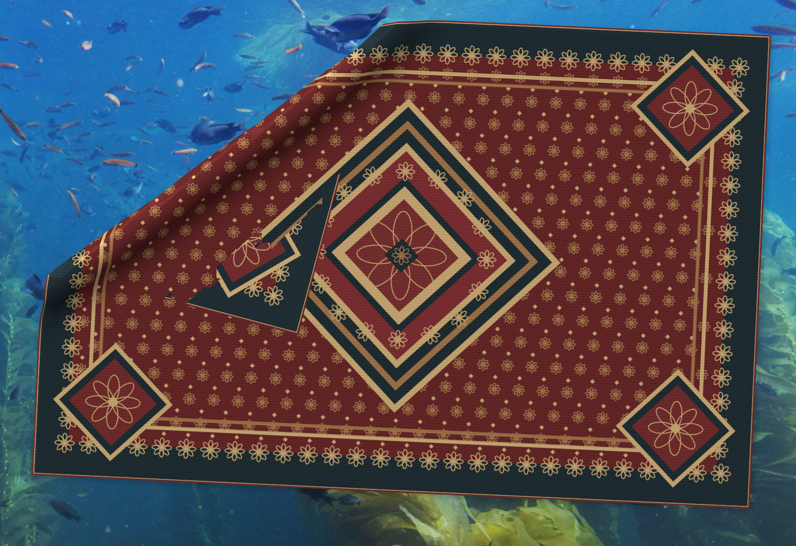

# 桌面魔毯 · Desktop Magic Carpet

在你的 Mac 桌面上铺一块可以掀起、拖动、折叠的魔毯。用鼠标抓住它，感受弹性布料、织纹和实时阴影；松手后，它会自然落下。

**作者： [zlbigger](https://zlbigger.com) · 作者主页：[zlbigger.com](https://zlbigger.com)**

[下载 Mac 应用](https://github.com/zlbigger/desktop-magic-carpet/releases/latest) · [使用说明](#使用方法) · [本地开发](#本地开发)

## 效果预览



> 实机交互截图，来自早期原型，用于展示外观和掀起效果。v0.1.1 已加入非相邻顶点与三角面的自碰撞和拖拽限速，减少截图中的上下层穿插；极端折叠仍可能出现边缘穿插。

## 功能

- **抓住并掀起**：弹性布料网格，支持拉动、抬起、折叠和松手落下。
- **原创织纹**：几何花纹与织物质感，通过代码生成，无需下载贴图。
- **实时阴影**：布料随形变产生阴影，增强立体感。
- **透明桌面叠层**：地毯外的透明区域支持鼠标穿透。
- **托盘控制**：重新铺平、暂停物理、显示或隐藏、切换置顶及退出。
- **本地运行**：不需要账号，不连接远程服务，不读取或修改桌面文件。

## 安装 Mac 应用

1. 打开 [Releases](https://github.com/zlbigger/desktop-magic-carpet/releases/latest)，下载 `DesktopMagicCarpet-macOS-arm64-v0.1.1.zip`。
2. 解压后，将 `DesktopRug.app` 拖到「应用程序」文件夹，或直接双击运行。
3. 若魔毯被其他窗口挡住，可在菜单栏托盘中开启「总在最前面」。

当前提供 **Apple Silicon（M1 / M2 / M3 / M4 等）Mac** 版本。应用已做本地 ad-hoc 签名，尚未经过 Apple Developer ID 签名和公证；首次打开可能受到 macOS 的安全检查。请按系统提供的正常流程处理，不要关闭系统安全保护。Intel Mac 暂无预编译下载包。

应用内已包含运行环境，使用下载版无需安装 Node.js，无需终端，也无需额外下载依赖。

## 使用方法

| 操作 | 效果 |
| --- | --- |
| 按住地毯拖拽 | 掀起、拉动布料 |
| 拖拽时滚轮 | 调整抬起高度 |
| Shift + 拖拽 | 移动整块地毯 |
| 双击地毯 | 重新铺平 |
| Esc | 松开抓取 |
| 右键地毯 / 点击菜单栏托盘 | 打开设置菜单 |
| ⌘ + Shift + R | 显示 / 隐藏 |
| ⌘ + Shift + Q | 退出 |

## 实现与边界

基于 **Electron + Three.js**。物理模型采用 Verlet 积分，包含结构、剪切和弯曲约束、地面碰撞、非相邻顶点与三角面的自碰撞，以及抓取位移限速。

这是桌面叠层应用，不是系统壁纸层级，也不会收纳、移动、隐藏或删除桌面文件；地毯只会在视觉上遮挡下方内容。默认不置顶。极端折叠仍可能有边缘穿插；不同 macOS 版本、显示器和显卡的透明窗口、点击穿透与托盘表现需要实机验证。源码保留 Windows 启动方式，但本次仅发布 macOS arm64 应用。

渲染页面仅加载本地资源，启用 `contextIsolation` 和 `sandbox`，不向页面暴露 Node.js。Electron 和 Three.js 的许可证随发行包保留。

## 本地开发

建议 Node.js 24 LTS 或更新的兼容版本。

```bash
npm ci
npm start
```

macOS 也可以双击项目里的 `启动桌面地毯.command`。脚本会读取已启用的 macOS 系统 HTTP/HTTPS 代理，供依赖下载使用。

```bash
npm test
npm run package:mac
```

`npm test` 包含落地稳定性、抬起与释放、平移复位、快速抓取限速和自碰撞分离共 5 项测试。`package:mac` 生成 Apple Silicon 应用到 `release/`；本地分发前需重新签名：

```bash
codesign --force --deep --sign - release/DesktopRug-darwin-arm64/DesktopRug.app
codesign --verify --deep --strict release/DesktopRug-darwin-arm64/DesktopRug.app
```

本地签名不等于 Apple 公证。若面向更大范围发行，可使用自己的 Developer ID 证书签名和公证。

## 许可

源码采用 [MIT License](LICENSE)。

由 [zlbigger](https://zlbigger.com) 制作。
